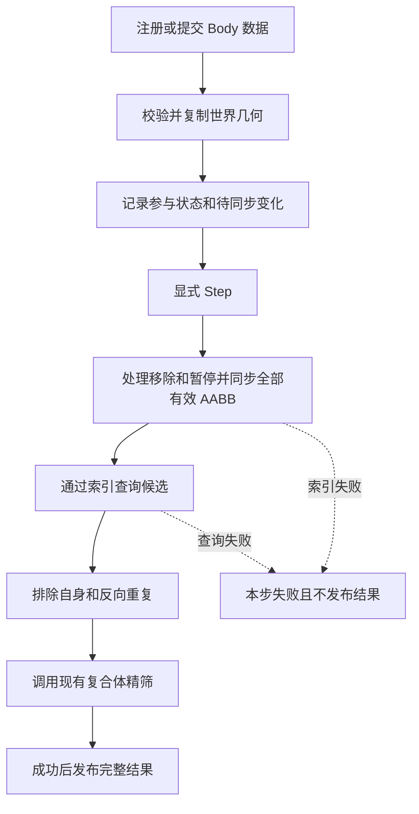

# 接口版碰撞世界：代码计划与位置修正边界

日期：2026-10-28。目标项目：`D:/UnityProject/AshFramework`。

**后续范围更新：** 接口、Unity 接入及说明场景已提交后，用户确认实现首个均匀网格并接入示例。新增 UniformGridBroadPhase2D，保持 IBroadPhase2D 不变；固定范围格子表、完整 AABB 跨格登记、逐项更新/移除、代理去重代数和桶复用。示例 Start 显式注入，Step 仍手动触发，并显示碰撞对、ID 和暂停原因。后文“只接接口”属于前两阶段的历史范围，当前以本段和 README 为准；位置修正仍未实施。

本阶段新增 26 项测试，最终原生碰撞程序集 209/209 通过，失败和目标跳过均为 0；全模块 C# 构建与格式、Editor 编译通过，CLI 筛选测试因参数兼容 blocked。Play 中实际验证移动/还原和禁用/启用产生 1/0/1 配对变化且 ID 不变。详细证据及未执行范围见 [验收清单](../TASK-CHECKLIST.md)。本阶段没有自动提交。

本文最初整理下一阶段计划；用户后续要求“完成第一步”，并在核心提交后确认继续第二阶段。现已完成第 2 节核心及第 3 节 Unity 接入。已确认需求见 [讨论备忘](CollisionWorldDiscussionMemory.md)，参考结论见 [LightweightPhysics 审查](LightweightPhysicsReferenceReview.md)。本文取代旧调查中先做暴力基线、先实现具体空间索引或同步加入高度过滤/事件的近期实施顺序。

**第一阶段实际状态（2026-10-28）：** 已实现接口、世界、身份/配对/记录、公开的 CompoundShape2D.CopyFrom 与测试 Stub。采用普通记录数组、ID 映射、空闲/已注册槽位列表；查询结果规范化排序；失败后 Clear 重建。另提供只读状态查询，完整公开行为见 [README](../README.md)。本项目原生 EditMode 158/158 通过，C# 构建/格式及 Editor 编译通过；CLI 测试入口参数兼容仍 blocked。证据见 [验收记录](../TASK-CHECKLIST.md)。下文签名表保留设计来源，第一阶段这些方法已存在，Unity/修正部分仍是计划。

## 1. 最新要求与范围

- 用户明确要求忘掉 Jobs 布局：当前按普通 C# 对象、数组和集合设计，不以 Jobs/Burst、NativeArray 或全局扁平形状布局作为目标，也不为此增加程序集或改写 Math。
- 用户要求记录并解释四项借鉴方向：接口注入、稳定 ID 与内部槽位分离、受控数据修改、数组及缓冲复用。下面的具体容器和方法安排属于据此整理的实施建议，不将此前讲解自动视为用户逐项确认了所有实现细节。
- 继续采用已确认的独立几何副本、显式 World 绑定、禁用保留身份、Body 数据错误暂停、显式 Step。
- 当前只接空间索引接口，不实现具体空间划分、不提供正式暴力/空索引兜底。没有索引实现时不执行真实检测。
- 位置修正作为需要考虑的未来扩展，首阶段只建立可安全更新几何与索引的边界，不加入修正算法、接触占位类、求解器、质量或速度积分。

## 2. 第一阶段：最小核心世界

### 2.1 计划文件

```text
Assets/AshFramework/Collide/
    BroadPhase/
        IBroadPhase2D.cs
    World/
        CollisionWorld.cs
        CollisionBodyId.cs
        CollisionPair.cs
        CollisionBodyRecord.cs
    Shape/
        CompoundShape2D.cs                 修改：增加受控复制入口
    Tests/Editor/
        CollisionWorldTests.cs
        CompoundShapeTests.cs              补充复制行为测试
        TestDoubles/
            StubBroadPhase2D.cs            仅预设候选及记录调用，不实现空间算法
```

业务核心继续留在现有 AshFramework.Collide 程序集，保留 noEngineReferences 和禁止 unsafe 的设置。第一阶段不修改 Body 组件绑定，不制作场景或 Prefab；Unity 接入放在第二阶段。

### 2.2 四项借鉴方向如何落地

| 方向 | 当前建议 | 要保证的性质 |
| --- | --- | --- |
| 接口注入 | 核心构造函数接收一个空的 IBroadPhase2D，由该世界独占管理 | 世界不创建或判断具体算法，外部不同时修改该索引 |
| ID 与槽位分离 | ID 到槽位字典、内部记录数组、空闲槽位列表 | 复用槽位不复用旧身份；跨世界或已移除 ID 不能操作到其他对象 |
| 受控修改 | 注册、几何提交、暂停、移除经过世界入口；记录不对外暴露为可变对象 | 身份、几何与索引状态始终由世界协调 |
| 数组及缓冲复用 | 记录和几何保留容量；复用候选与工作结果列表 | 不每步创建容器，容量与有效数量分开管理 |

内部记录可以是普通 class，数组存的是记录引用，不要求所有几何连续打包。几何容器与节点/格子归属不能暴露为公共可写字段。

另建议维护已注册槽位列表，遍历它而非历史最高分配范围，避免参考实现删除很多对象后仍扫描大量空槽。暂停对象仍保留在注册列表，按状态跳过检测；移除可交换列表尾项，但需同步维护内部列表位置，不能依赖槽位顺序表示外部身份。

禁用保留记录、ID 和容量。销毁或解绑才回收存储；旧 ID/状态/几何必须清理，未完成索引清理的槽位不能提前交给新身份。ID 数值分配、世界归属校验和耗尽处理应在实现时一并完成，不只依赖裸整数相等。

### 2.3 几何副本

1. 从有效 CompoundShape2D 读取源形状及已计算的整体 AABB。
2. 检查源容器有效、逻辑高度有效，完整范围位于世界覆盖范围内。
3. 目标几何数组仅在容量不足时扩容，复制有效形状和对应缓存 AABB，更新有效数量，处理旧尾部。
4. 不重新计算三角函数，不重复合并已验证的整体 AABB，不另接收一份独立可写范围。
5. 单线程阶段内完成，源不得同时被修改。复制容器的内部细节不暴露给业务调用方。
6. 空/无效提交使该 Body 暂停并撤下旧索引项，不能因为底层复制保留旧数据而继续检测旧几何。

已在 CompoundShape2D 增加公开 CopyFrom 入口，可供同类容器受控复制；世界内部记录和副本仍不公开。纯复制路径可以复用数组，但不据此承诺整个几何准备或精筛零 GC。性能需另行测量。

### 2.4 对外方法签名草案

下面是方法约定，不是已存在 API，也不是完整可编译类定义。调用者在所属世界中使用有效 ID；未知或跨世界 ID 的错误不得隐式创建记录。

| 所属类型 | 拟定签名 | 行为 |
| --- | --- | --- |
| CollisionWorld | CollisionWorld(Aabb2D worldBounds, IBroadPhase2D broadPhase) | 校验固定覆盖范围和非空索引；索引应是空实例且独占使用 |
| CollisionWorld | CollisionBodyId RegisterBody() | 分配身份，初始为暂停，尚无有效几何 |
| CollisionWorld | bool TrySubmitGeometry(CollisionBodyId id, CompoundShape2D source, LogicalHeight height, out string error) | 校验并复制；有效后安排参与检测，数据错误暂停该 Body |
| CollisionWorld | void SuspendBody(CollisionBodyId id) | 保留身份，安排撤下索引项 |
| CollisionWorld | bool UnregisterBody(CollisionBodyId id) | 移除注册与索引；不存在时返回 false |
| CollisionWorld | bool Step(List<CollisionPair> results, out string error) | 同步全部索引后检测，成功才发布完整结果 |
| IBroadPhase2D | void Insert(CollisionBodyId id, Aabb2D bounds) | 插入新 ID；重复登记明确失败 |
| IBroadPhase2D | void Update(CollisionBodyId id, Aabb2D bounds) | 只更新已登记 ID，不隐式插入 |
| IBroadPhase2D | bool Remove(CollisionBodyId id) | 移除；不存在时返回 false |
| IBroadPhase2D | void Query(Aabb2D bounds, List<CollisionBodyId> results) | 追加保守候选；覆盖相交和相切，本次追加无重复，不保证顺序 |
| IBroadPhase2D | void Clear() | 清空索引，保留配置；不清世界身份 |

核心 Step 不读取 Transform。Unity 层未来先刷新和提交全部组件数据，再调用核心 Step。当前不需要 dt，因为不做运动积分。

结果列表建议在 Step 入口清空，内部工作缓冲完成全部计算后才写入；返回 false 时列表为空，调用者必须结合成功标志区分失败与没有碰撞。最终 ID 对排序仍是推荐行为，不据此宣称完整锁步。

### 2.5 数据流与错误边界



- Body 几何错误、越界或 Unity 平面不一致：暂停对应对象、报告原因，其余有效对象继续。
- 索引操作错误：整步失败，不能跳过错误继续查询，也不能发布上步或部分结果。
- 索引可能在失败前已同步了一部分对象。失败不等于自动回滚；世界应标记需要重新同步。建议下次检测前先 Clear，再按当前有效记录重建，全部成功后才恢复查询；Clear 或重建再次失败则继续报告失败。
- 对外修改入口禁止检测中重入；当前没有事件，不先增加回调系统。未来引入事件后另设计延后命令处理。
- 未知/失效的索引候选表示内部不一致，应暴露错误，而不是静默忽略。

### 2.6 第一阶段验收

- 几何复制独立：源修改/清空不影响世界；整体 AABB 与副本匹配；缩减和扩容不会暴露旧尾部。
- 稳定身份：暂停恢复 ID 不变；移除后旧 ID 失效；槽位复用不会访问新对象；不同世界不能混用 ID。
- 同步顺序：全部 AABB 更新和失效移除先于第一次 Query；无需移动也能持续检测有效对象。
- 配对：自身排除、A/B 反向只检测一次、额外候选经现有精筛排除，相切仍算重叠，逻辑高度不参与过滤。
- 错误：空几何、越界会暂停并清理旧项；索引插入/更新/移除/查询失败不会发布部分结果；失败后重新同步再恢复查询。
- 生命周期与容器：重复移除、暂停后移除、记录/槽位复用、多世界缓冲隔离、容量稳定时的复用行为。
- Stub 只返回预设候选、记录操作顺序并模拟失败，不实现运行时暴力或空间划分；验收的是世界流程，不是未来索引完整性或性能。

## 3. 第二阶段：Unity 绑定与检查

**实际状态（2026-10-28）：已实现。** 新增 CollisionWorldBehaviour、World/Body Inspector 和只读 CollisionWorldValidation，修改 Body 显式绑定与生命周期。新增 23 项测试，本项目原生 EditMode 整个碰撞程序集 181/181 通过；C# 与 Editor 编译通过，CLI 筛选测试仍 blocked。实际公开签名和使用边界见 [README 的 Unity 世界接入](../README.md#unity-世界接入)，下列内容是本阶段的设计来源。

初始化与显式 RefreshBindings 发现包括禁用对象的场景绑定；Step 只遍历已跟踪记录，不每步扫描全场景。运行时修改使用 BindWorld，绕过该入口的批量序列化修改后显式 RefreshBindings。OnValidate 不遍历场景、不修改核心世界；Body Inspector 在主线程协调字段变更。运行时初始化状态不持久化，域重载后重新注入。

World 自身禁用时保留身份并暂停，Step 拒绝运行；启用后可继续。初始化后配置固定，绕过入口修改将使 Step 失败，恢复原配置后继续。销毁时清空独占索引，不 Dispose 其他资源。按钮逻辑已经测试；本轮尚未完成 Inspector 外观的人工视觉验收。

第一阶段核心验证后，再新增 CollisionWorldBehaviour 和 World Inspector，修改 CollisionBodyBehaviour 的显式绑定入口。保留已有 Shape 归属、显式重建和 Gizmos 不改写检测缓存的约定。

- 计划入口：Body.BindWorld(world)、WorldBehaviour.Initialize(broadPhase)、WorldBehaviour.Step(results, out error)，名称均为拟定。
- 未初始化时只保存 Unity 绑定关系，不制造核心假 ID；提供索引后创建核心世界并登记，包括已绑定但禁用的对象。
- 禁用保留核心身份并暂停，启用后重新准备有效数据；销毁、解绑、转移世界统一清理。需覆盖 World 先后初始化、Body 先后启用及世界销毁顺序。
- 外部逻辑帧调用 Unity Step；先统一刷新、校验平面并提交几何，再调用核心 Step。不默认挂 Update/FixedUpdate。
- Inspector 提供统一平面、固定碰撞覆盖范围及只读“检查平面一致性”按钮，检查明确绑定的对象并包含禁用对象；无 Body 时明确说明。
- 没有具体索引时显示未初始化，不用空结果冒充成功；按钮可独立工作，不创建算法选择空配置。

## 4. 未来的位置修正：现在考虑边界，后续单独实现

用户提出位置修正需要纳入考虑，但没有确认求解方式、谁移动、阻挡类别或权威姿态来源。以下是扩展建议，不是首阶段新增功能或已经定稿的物理规则。

### 4.1 现有缺口

当前 CompoundCollision2D.Overlaps 仅返回布尔值，不提供法线、穿透深度或命中子形状。未来需要接触信息及移动规则，不能直接从当前布尔结果计算修正量，也不提前创建无实现的接触接口占位。

### 4.2 一致性边界

```text
检测得到接触信息
    → 移动策略决定谁移动、移动多少
    → 更新唯一的权威姿态
    → 通过受控入口更新所有所属世界形状及缓存范围
    → 更新整体 AABB 和索引
    → 必要时有限次数复检
    → 明确结果对应修正前还是修正后，再交付表现/玩法
```

- 不只修改一个 Position 字段，也不只挪索引 AABB。世界现在保存世界空间形状，移动后形状与所有相关范围必须同步。
- 不让未来求解器取得可变内部记录后任意修改；任何几何更新都经过世界维护的一致性入口。专用平移入口仅在该阶段有真实需求时再设计。
- 若 Transform 是当前来源，外部移动后需刷新并重新提交；若未来逻辑定点姿态权威，则先更新逻辑，再生成几何与表现。不能修正世界副本后，又被旧输入覆盖。
- 保持已提交几何是检测阶段的稳定输入；若同一步迭代修正，应显式建立下一轮工作几何，完成索引同步后再查询，不边遍历候选边任意改底层数据。
- 相切在当前检测中为 true，但不等于需要非零推开量。接触方向、零深度、容差和过度修正需在接触阶段定义。
- 多子形状、多墙角接触需要组合处理与有限迭代，不能把第一个命中子形状的修正量当作整个复合体的完整解。
- 离散重叠后的推开与移动过程中防穿墙不同；后者可能需要扫掠与滑动。首阶段不承诺连续碰撞或角色移动求解。
- 质量、速度、冲量和求解器不因需要位置修正而自动进入当前 Body 数据。

## 5. 执行顺序与验证

1. 核心身份与记录管理、复合体受控复制、公共索引契约。
2. 核心世界的同步/配对/精筛/失败恢复与测试 Stub，作为第一份可独立验收的代码交付。
3. Unity 绑定、显式驱动和 Inspector 检查，作为第二份交付。
4. 具体空间算法、位置修正/移动及其他功能以后按需求分别安排；当前不因布局考虑引入 Jobs。

未来实施时在 AshFramework 执行：

```powershell
python .codex/scripts/workflow.py verify --task csharp --include Assets/AshFramework/Collide
python .codex/scripts/workflow.py verify --task editor --test-filter AshFramework.Collide.Tests
```

Editor 验证前核对规范化绝对项目路径和唯一 ready 实例；缺少工具或 Pipeline 时报告 blocked，不安装依赖、不关闭用户 Editor、不借其他项目补验收。零测试或全部跳过不算通过。机器验证与第二阶段实际 Inspector 行为检查分开记录，历史 130 项通过不能当成新增世界测试结果。

最初计划阶段仅执行 docs。后续第一阶段实施的 C#/Editor/原生测试结果按文首状态及验收清单记录，不将历史文档检查冒充业务验收。
