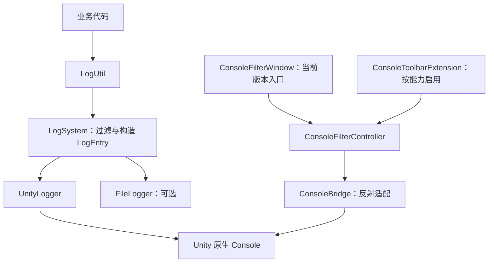

# AshFramework 日志系统与 Console 筛选设计稿

状态：设计已实现，代码位于 `Assets/AshFramework/Log`；使用说明见模块内 README.md。

目标环境：当前项目 Unity 2022.3.62f1c1。

## 1. 最终方案

以 `LogUtil → LogSystem → ILogger` 为运行时核心，默认实现 `UnityLogger` 和可选的 `FileLogger`。Editor 部分复用 Unity 原生 Console 的日志列表，通过分类前缀和搜索接口进行筛选。

当前版本使用可停靠的 `ConsoleFilterWindow` 作为筛选入口。未来 Unity 版本存在兼容的工具栏扩展点时，由 `ConsoleToolbarExtension` 把同一套操作显示在原生 Console 工具栏中。

两个入口共用筛选控制器，不维护第二份日志列表，不重新实现原生 Console 的折叠、日志数量、等级按钮、Error Pause 和源码跳转。



## 2. 参考实现与兼容性结论

### 2.1 参考来源

- ARPG-Demo：`Assets/Framework/Common/Debug`。参考统一配置、颜色、元数据和异步文件记录思路。
- TEngine：`UnityProject/Assets/TEngine/Runtime/Core/Log`。参考静态门面、核心分发与可替换日志实现。
- AChenConsoleExtension：`Assets/Scripts/LogSystem`。参考分类常量、分类前缀、Console 搜索适配和 Editor/Runtime 分离。

### 2.2 本地程序集核查

核查对象为当前项目引用的：

`D:/unityEditor/2022.3.62f1c1/Editor/Data/Managed/UnityEngine/UnityEditor.CoreModule.dll`

通过程序集元数据读取确认：

| 内部成员 | 当前版本情况 | 用途 |
| --- | --- | --- |
| `UnityEditor.ConsoleWindow` | 存在 | 获取原生 Console 类型 |
| `ConsoleWindow.ms_ConsoleWindow` | 存在 | 获取窗口实例 |
| `ConsoleWindow.SetFilter` | 存在 | 搜索适配候选方法 |
| `LogEntries.GetFilteringText` | 存在 | 读取当前搜索文本 |
| `ConsoleWindow.drawCustomToolbarGui` | 不存在 | 无法直接照搬参考插件的工具栏挂载 |

以上成员情况通过程序集元数据核查。实现已包含签名检测，原生搜索读写已在 Unity 2022.3.62f1c1 EditMode 集成测试中验证；窗口视觉布局尚未手动验收。

AChen 的 `IsAvailable` 同时依赖类型和工具栏事件。直接复制到当前版本会导致分类工具栏无法注册，即使搜索接口存在也用不上。

本方案分别检测搜索读写和工具栏挂载能力。当前版本以筛选窗口驱动原生 Console；不会为工具栏外观引入方法替换或 OnGUI Hook。

## 3. 最终功能范围

| 部分 | 确定功能 |
| --- | --- |
| 日志入口 | `Debug / Info / Warning / Error / Fatal / Exception` |
| 模块分类 | 预定义分类常量、配置中的自定义分类、Default 回退 |
| 日志过滤 | 总开关、运行时最低等级、控制台与文件独立最低等级 |
| 日志信息 | 时间、等级、分类、线程；主线程可选帧号 |
| 控制台表现 | 统一前缀、按等级默认颜色、可选自定义颜色、Unity 对象关联 |
| Console 浏览 | 单分类筛选、全部框架日志、全部 Console 日志、恢复原搜索 |
| 原生功能 | 保留原生关键词搜索、等级按钮、Collapse、Clear、Error Pause、源码跳转 |
| 偏好设置 | 筛选状态使用项目会话状态，开发者偏好与 Player 配置分开保存 |
| 文件记录 | 可选；异步写入、大小滚动、保留清理、正常关闭时排空队列 |
| 扩展能力 | 通过 `ILogger` 接入新的输出目标 |

Console 筛选只改变“现在显示哪些已输出日志”，不改变日志生成和文件记录。运行时等级过滤决定是否产生记录，已过滤掉的日志无法通过 Console 筛选找回。

### 3.1 本版筛选能力的边界

本版采用原生 Console 的文本搜索，提供单分类筛选，并与原生 Info/Warning/Error 按钮组合使用。它是按约定前缀进行文本匹配，并非结构化字段查询。

分类与用户自由关键词共用原生搜索框。本版采用“分类模式 / 手动搜索模式切换”，保留并恢复原搜索文本；不假定多个搜索词等同于 AND，也不承诺分类与任意关键词同时匹配。

Debug、Info 都映射为原生普通日志；Error、Fatal 和本系统的 Exception 都映射到原生错误组。五个框架等级仍写入前缀与文件，但原生三个等级按钮不会因此变成五个按钮。

多分类 OR、分类与关键词精确组合、独立分类计数、正则与时间范围查询，需要单独的数据查询与显示能力，列为后续增强。

调用栈图是参考插件中的另一项能力，不并入本版分类筛选。当前保留原生堆栈和源码跳转。

## 4. 分类与日志格式

### 4.1 分类命名

统一使用 `category`，不再同时使用 `tag` 表示相同概念。

```csharp
namespace AshFramework.Logging
{
    public static class LogCategories
    {
        public const string Default = "Default";
        public const string Framework = "Framework";
        public const string UI = "UI";
        public const string Network = "Network";
        public const string Resource = "Resource";
        public const string Battle = "Battle";
        public const string Event = "Event";
    }
}
```

分类使用字母、数字、下划线、点和连字符；不允许空格、方括号或换行。空值映射为 Default；非法分类回退到 Default，并使用受控诊断提示。中文业务描述放在日志正文中。

筛选菜单来自 `LogCategories` 中的公开字符串常量与设置中的自定义分类，去重并稳定排序。允许业务传入合法自定义字符串；如果希望它出现在菜单中，需要把它加入上述任一来源。

列表在初始化或配置改变时刷新，不在每次 GUI 绘制中反射，也不依赖运行时已经输出过哪些日志。

### 4.2 稳定前缀

```text
[Ash][C:UI][L:Info] [16:30:20.123][T:1][F:320] 打开背包窗口
[Ash][C:Network][L:Error] [16:30:21.456][T:6] 连接服务器失败
```

搜索约定：

| 操作 | 写入原生搜索框 |
| --- | --- |
| 全部框架日志 | `[Ash][C:` |
| UI 分类 | `[Ash][C:UI]` |
| Network 分类 | `[Ash][C:Network]` |
| 全部 Console 日志 | 空字符串 |

规则：

1. `[Ash][C:分类]` 是固定、连续的检索标记，显示前缀配置不能改动它。
2. 可配置的产品前缀、时间和线程信息放在固定标记之后。
3. 控制台只为等级标记或正文添加颜色；固定检索标记中间不插入富文本标签。
4. 文件从原始 `LogEntry` 格式化，不把控制台加色后的字符串写入文件。
5. 普通 `Debug.Log` 不含系统标记，分类筛选时自然不会命中；清空搜索后仍显示。
6. 正文若恰好包含同样的标记，原生文本搜索也可能命中；不对文本搜索承诺结构化精确性。

## 5. 三个核心类型

以下代码为接口契约摘录，不是可直接粘贴运行的完整实现。

### 5.1 LogUtil：业务入口

```csharp
public static class LogUtil
{
    public static bool IsEnabled(LogLevel level,
        string category = LogCategories.Default);

    // 所有 Debug 重载使用相同的 Conditional 条件。
    [System.Diagnostics.Conditional("UNITY_EDITOR")]
    [System.Diagnostics.Conditional("DEVELOPMENT_BUILD")]
    [System.Diagnostics.Conditional("ASH_LOG_DEBUG")]
    public static void Debug(string message,
        string category = LogCategories.Default,
        UnityEngine.Object context = null);

    public static void Info(string message,
        string category = LogCategories.Default,
        UnityEngine.Object context = null);

    public static void Warning(string message,
        string category = LogCategories.Default,
        UnityEngine.Object context = null);

    public static void Error(string message,
        string category = LogCategories.Default,
        UnityEngine.Object context = null);

    public static void Fatal(string message,
        string category = LogCategories.Default,
        UnityEngine.Object context = null);

    public static void Exception(System.Exception exception,
        string category = LogCategories.Default,
        UnityEngine.Object context = null);

    // Format 系列固定要求 category，避免两个 string 参数导致重载含义不明确。
    public static void InfoFormat(string category, string format,
        params object[] args);

    // 其余等级提供相同的 Format 系列。
    public static void LogColor(LogColor color, string message,
        string category = LogCategories.Default,
        UnityEngine.Object context = null);
}
```

- `LogColor` 默认按 Info 记录，颜色不改变严重程度。
- `Exception` 使用异常的 `ToString()` 快照保留原始堆栈，按 Error 记录。控制台只输出一次带分类前缀的错误，不同时重复输出 Error 和 Exception。
- `Fatal` 记录严重错误，不在日志工具内部终止应用。
- Format 方法先检查是否启用，再格式化；格式化错误通过应急诊断处理，不抛回业务调用点。
- 允许补充 1～3 参数泛型 Format 重载，但不宣称其天然零分配。
- 运行时过滤不能消除调用参数求值成本，昂贵日志由业务使用 `IsEnabled` 包围。

### 5.2 LogSystem：过滤、构造和分发

```csharp
public static class LogSystem
{
    public static bool IsInitialized { get; }

    public static void Initialize(LogConfig config,
        params ILogger[] additionalLoggers);

    public static bool IsEnabled(LogLevel level,
        string category = LogCategories.Default);

    public static bool Flush(int timeoutMilliseconds = 1000);
    public static bool Shutdown(int timeoutMilliseconds = 2000);

    // 内部统一入口，由 LogUtil 调用，不附加 Conditional。
    internal static void Write(LogLevel level, string message,
        string category, UnityEngine.Object context,
        LogColor color, string exceptionText = null);
}
```

固定处理顺序：

```text
总开关与等级检查 → 规范化分类 → 判断至少一个目标接收
→ 构造 LogEntry → 按各目标门槛分发 → 输出器各自处理
```

- 初始化和退出在主线程执行，输出器接收日志需支持并发调用。
- 未初始化时使用默认控制台回退，保留启动阶段日志；文件记录从初始化完成后开始。
- 初始化时创建自己的配置快照，外部直接修改原配置不会改变工作线程行为。
- 重复 Initialize 不重复创建线程或事件订阅；保留已初始化系统，提示一次。
- 本版不提供运行中任意添加、替换输出器的接口。需要调整时在明确的生命周期节点关闭并重新初始化。
- 传入的额外输出器由 LogSystem 接管生命周期，不与其他系统共享释放责任。
- 每个输出器单独隔离异常，失败不会阻止其他输出器。
- 系统自身错误走带重入保护、限次的应急诊断，不再进入正常分发链。
- Flush/Shutdown 的超时是整次调用的时间预算，不为每个输出器重新开始计时。
- Shutdown 先关闭入口，并在预算内等待已进入分发的调用完成，之后再刷新；避免“刷新结束后仍有旧调用入队”。超时则报告未完成，继续由内部收尾流程释放资源。

### 5.3 ILogger：输出接口

```csharp
namespace AshFramework.Logging
{
    public interface ILogger : System.IDisposable
    {
        void Log(in LogEntry entry);
        bool Flush(int timeoutMilliseconds);
    }
}
```

`Log` 接收完整记录，允许实现内部异步入队；返回不表示已经写盘。`Flush` 成功表示调用前已接收的记录完成该目标的刷新。`Dispose` 由 LogSystem 在生命周期结束时调用，实现必须可重复调用，并与失败后的清理兼容。异步输出器的 Dispose 只通知停止并安排资源释放，不无限等待；需要等待的部分由带超时的 Flush 和系统收尾流程管理。

Unity 自带同名 `UnityEngine.ILogger`，引用冲突时使用完整名称或别名。

## 6. LogEntry 和输出器

### 6.1 LogEntry

`LogEntry` 是一条日志的数据快照，不负责显示或写文件。使用只读结构体，最少包含：

| 字段 | 类型 | 说明 |
| --- | --- | --- |
| Sequence | long | 会话内递增标识；并发时不承诺等于各输出器最终显示顺序 |
| Timestamp | DateTimeOffset | 调用时采集，带时区偏移 |
| Level | LogLevel | Debug / Info / Warning / Error / Fatal |
| Category | string | 规范化后的分类 |
| Message | string | 原始正文 |
| ThreadId | int | 日志产生线程 |
| FrameCount | int? | 主线程采集；工作线程留空 |
| ExceptionText | string | 可选异常快照 |
| Context | UnityEngine.Object | 仅供主线程控制台关联对象 |
| Color | LogColor | 可选显示颜色 |

文件线程不访问 Context，不读取 Unity 属性，也不对延迟持有的业务对象调用 ToString。第一版不为每条普通日志主动构造托管 StackTrace；Console 堆栈使用原生能力，文件保证保存显式传入异常的堆栈。

### 6.2 UnityLogger

- Debug / Info → 普通日志，Warning → 警告，Error / Fatal / Exception → 错误。
- 主线程同步输出，以保留正常调用点堆栈；适用时使用 `HideInCallstack` 隐藏转发方法，并在目标 Editor 验证双击位置。
- 工作线程不读取 Unity 对象或帧号，将控制台显示操作交给主线程队列。运行时由内部 `LogRuntimeDriver.Update` 排空，Editor 非播放状态由 Editor update 排空。
- 工作线程日志的 Unity 原生堆栈会指向转发位置，文件与正文仍保留显式异常的原始堆栈；本版不承诺工作线程普通日志双击直达原始业务行。
- 主线程待显示队列同样有容量限制和溢出摘要，避免 Console 消费不及时导致无限积压。
- 主线程调用 Flush 时主动排空待显示队列，避免主线程等待自己处理队列。整体关闭只在主线程执行。

### 6.3 FileLogger

- 默认开关可配置，目录由主线程在初始化时解析，例如 `Application.persistentDataPath/Logs`。
- 使用单个后台消费者与有界队列；按间隔或批次写入 UTF-8 文本。
- 按文件大小滚动，按保留文件数清理；会话文件名包含时间与唯一会话标识。
- 队列满载允许丢弃低等级日志，记录丢弃摘要；为 Error/Fatal 预留容量。仍无法接收时使用应急诊断，不能承诺过载时零丢失。
- 可配置单条日志大小上限，避免仅限制条数仍被超大正文占满内存。
- 正常关闭：停止接收 → 通知完成 → 排空已接收记录 → 刷新 → 消费者关闭文件 → 等待完成。
- 等待超时返回失败，由消费者保留文件资源所有权并继续清理；主线程不强行关闭仍在使用的流。
- 强制结束进程或断电时不保证最后一段日志保留。

本版文件只记录经过 LogUtil/LogSystem 的日志。原生 Debug.Log、第三方日志及 Unity 自动异常仍由原生 Console 显示；若要统一写入自定义文件，后续增加带明确去重规则的采集桥接。

## 7. Console 筛选交互

### 7.1 界面

菜单：`Tools/AshFramework/Logging/Console Filter`。

```text
┌ Ash Log Filter ────────────────────────────────────┐
│ 分类 [全部框架日志 ▼]   [打开 Console]              │
│ [全部 Console 日志] [恢复原搜索] [设置]              │
│ 当前：分类/UI   ·   原生搜索：[Ash][C:UI]            │
│ 提示：关键词请使用 Console 搜索框，输入后转手动模式。 │
└───────────────────────────────────────────────────┘
```

窗口可手动停靠到 Console 附近。本版不通过内部布局 API 自动修改用户 Editor 布局。

分类菜单包含“全部框架日志”和全部注册分类。“全部 Console 日志”单独作为显式清空原生搜索的动作。

### 7.2 搜索所有权与恢复规则

状态分为 `None`、`Framework`、`Category`、`Manual`，控制器保存：

```text
Mode                 当前模式
SelectedCategory     当前分类
PreviousSearchText   进入本轮分类筛选前的原生搜索
LastAppliedText      本工具上一次写入的搜索
OwnsSearch           当前搜索是否仍由本工具控制
```

| 场景 | 行为 |
| --- | --- |
| 原搜索 Boss，首次选择 UI | 保存 Boss；写入 `[Ash][C:UI]` |
| 从 UI 改为 Network | 写入 Network 标记；原搜索仍保存为 Boss |
| 点击恢复原搜索，当前仍由本工具控制 | 恢复 Boss，退出本工具筛选 |
| 用户手动将搜索改为 Sword | 检测变化，进入 Manual，放弃本工具搜索所有权 |
| 手动搜索后点击恢复原搜索 | 不覆盖 Sword，提示当前搜索已由用户修改 |
| 手动搜索后再次选择 UI | 将 Sword 作为新一轮原搜索，再应用 UI 筛选 |
| 点击全部 Console 日志 | 明确清空当前原生搜索，退出筛选并清理旧恢复状态 |
| 关闭筛选窗口 | 原生搜索继续生效，用户仍能在 Console 搜索框看到条件 |
| 脚本重编译后恢复状态 | 读取 SessionState 并比对原生搜索；不自动改写不匹配的搜索 |

仅当实际搜索与 LastAppliedText 相等且 OwnsSearch 为真时，允许“恢复原搜索”。所有写入均读取后比较，避免覆盖用户在两个入口之间的最新修改。

搜索变化在窗口可见时节流检查，并在执行操作前再次检查。不每帧反射访问，不每帧强制 Repaint。

### 7.3 兼容与降级

- 有工具栏事件且委托签名兼容：挂载轻量分类入口，复用控制器。
- 无工具栏事件，但搜索读写可用：使用 ConsoleFilterWindow，当前项目采用这一模式。
- 搜索能力不足或反射调用失败：显示一次兼容提示，提供“复制分类搜索词”和“打开 Console”，用户可粘贴筛选。
- 反射失败后禁用对应能力，不在每次 OnGUI 中重复抛异常。
- 注册必须幂等，脚本重载前移除事件，避免反复编译导致按钮重复。

## 8. Editor 类型设计

| 类型 | 职责 | 关键契约 |
| --- | --- | --- |
| ConsoleBridge | 集中封装内部 Console API | ProbeCapabilities、TryGetSearchText、TrySetSearchText、TryRegisterToolbar、OpenConsole |
| ConsoleFilterController | 生成查询、搜索所有权、状态切换 | ApplyCategory、ShowFramework、ShowAll、RestorePrevious、RefreshFromConsole |
| ConsoleFilterState | 保存会话状态 | Mode、SelectedCategory、PreviousSearchText、LastAppliedText、OwnsSearch |
| LogCategoryRegistry | 读取并缓存常量与配置分类 | GetCategories、Invalidate |
| ConsoleFilterWindow | 当前版本的可停靠 GUI 入口 | 只绘制并调用控制器 |
| ConsoleToolbarExtension | 按能力挂载工具栏 | 同一控制器，幂等注册与卸载 |
| LogSettingsEditor | 设置查看、编辑和创建 | 按用户动作创建资源，Undo、SetDirty、保存 |
| LogEditorLifecycle | Editor 更新与重载收尾 | 编辑态排空显示队列、重载前关闭、筛选事件卸载 |

Bridge 的读写契约示例：

```csharp
internal static class ConsoleBridge
{
    public static ConsoleCapabilities Capabilities { get; }

    public static bool TryGetSearchText(out string text);
    public static bool TrySetSearchText(string text, out string error);
    public static bool TryRegisterToolbar(System.Action draw,
        out System.IDisposable registration);

    public static void OpenConsole();
}
```

反射只在 Bridge 中出现，缓存类型与成员，并核查参数/返回值/委托签名。其他 Editor 类不直接引用 `ConsoleWindow` 的私有字段。

## 9. 配置与生命周期

### 9.1 配置分层

- `LogConfig`：普通 C# 运行时配置，Initialize 时取得快照。
- `LogSettings`：可选 ScriptableObject，保存默认运行配置与自定义分类，并可转换为 LogConfig。
- `ConsoleFilterState`：SessionState，保存本项目当前 Editor 会话的筛选状态，不写入 Player 配置。

建议配置：Enabled、MinLevel、DisplayPrefix、ShowTime、ShowThreadId、ShowFrameCount、EnableConsole、ConsoleMinLevel、EnableColor、EnableFile、FileMinLevel、FileDirectory、MaxFileSizeMB、MaxRetainedFiles、FlushIntervalMs、QueueCapacity、MaxEntryLength。

Player 日志开关放在设置界面，通过 Undo 和显式保存修改；不放到每次绘制的筛选按钮旁，也不在 OnGUI 中自动创建设置资源。业务可完全使用代码配置，不强制依赖 Resources 资源。

### 9.2 生命周期

- 主启动入口调用 Initialize。Initialize 创建内部运行时驱动并订阅正常退出；默认控制台回退不启动文件线程。
- 重复 Initialize 不重复创建驱动；Shutdown 可重复调用并解除订阅。
- Editor 在程序集重载和退出前尝试关闭；播放状态退出时清理本次运行的文件任务。
- 关闭 Domain Reload 时，通过运行时子系统重置入口清理上轮静态状态与事件，再允许本轮初始化。
- Editor 筛选控制器与运行时 LogSystem 分离，退出 Play Mode 不随意清空用户 Console 搜索。
- 不支持后台线程的平台，需要文件后端能力检测；第一版默认禁用该后端，不在初始化后才启动失败线程。

## 10. 推荐目录

```text
Assets/AshFramework/Log/
├── Runtime/
│   ├── AshFramework.Logging.asmdef
│   ├── LogSystem.cs
│   ├── ILogger.cs
│   ├── LogUtil.cs
│   ├── LogEntry.cs
│   ├── LogLevel.cs
│   ├── LogColor.cs
│   ├── LogCategories.cs
│   ├── LogConfig.cs
│   ├── LogSettings.cs
│   ├── LogRuntimeDriver.cs
│   ├── Formatting/
│   │   └── LogFormatter.cs
│   └── Loggers/
│       ├── UnityLogger.cs
│       └── FileLogger.cs
└── Editor/
    ├── AshFramework.Logging.Editor.asmdef
    ├── ConsoleBridge.cs
    ├── ConsoleFilterController.cs
    ├── ConsoleFilterState.cs
    ├── ConsoleFilterWindow.cs
    ├── ConsoleToolbarExtension.cs
    ├── LogCategoryRegistry.cs
    ├── LogSettingsEditor.cs
    └── LogEditorLifecycle.cs
```

Editor 程序集仅包含 Editor 平台并引用 Runtime。Runtime 不引用 UnityEditor。GUI 使用 IMGUI，匹配参考插件的轻量筛选入口，不增加 UI Toolkit 布局文件。

## 11. 使用示例

```csharp
// 主线程启动入口
LogSystem.Initialize(new LogConfig
{
    MinLevel = LogLevel.Debug,
    EnableConsole = true,
    ConsoleMinLevel = LogLevel.Debug,
    EnableFile = true,
    FileMinLevel = LogLevel.Info,
    FileDirectory = System.IO.Path.Combine(
        UnityEngine.Application.persistentDataPath, "Logs")
});

LogUtil.Info("打开背包窗口", LogCategories.UI, gameObject);
LogUtil.Warning("请求耗时较长", LogCategories.Network);
LogUtil.InfoFormat(LogCategories.Resource, "加载地图：{0}", mapId);

try
{
    LoadConfig();
}
catch (System.Exception exception)
{
    LogUtil.Exception(exception, LogCategories.Framework);
}

// 生命周期负责统一调用；业务不需要每次日志之后 Flush。
bool completed = LogSystem.Shutdown(2000);
```

## 12. 实现顺序与验收

1. 实现三个核心类型、分类、格式和 UnityLogger，验证分类标记稳定、对象关联及主线程源码定位。
2. 实现 ConsoleBridge 与筛选窗口，在当前 Unity 2022.3.62f1c1 验证实际搜索读写。
3. 实现搜索所有权、原搜索恢复和 SessionState，验证手动改搜索后不被覆盖。
4. 实现设置管理和按能力启用的工具栏入口，验证重编译不重复注册。
5. 实现 FileLogger，验证并发写入、队列满载摘要、滚动、正常排空及超时关闭。

关键验收场景：

- UI 与 Network 日志同时存在，选择 UI 只按约定前缀筛选，普通 Debug.Log 在清空搜索后仍能看到。
- 筛选 UI 时，Network 日志仍继续产生并写入文件。
- 从原搜索 Boss 进入 UI，再切 Network，恢复后仍为 Boss。
- 用户手动改搜索为 Sword 后，本工具不会用旧状态覆盖它。
- 工具栏事件不存在时筛选窗口仍可工作；搜索接口失效时可复制查询词。
- Runtime 构建不含 UnityEditor 引用；正式包中的 Debug 调用按宏裁剪。
- 正常退出与重编译不残留文件线程；关闭 Domain Reload 后多次播放不重复初始化。

实现已落在 `Assets/AshFramework/Log`，包含 Runtime、Editor 和 EditMode 测试。Unity 2022.3.62f1c1 的 14 项 EditMode 测试全部通过；Runtime 在不引用 UnityEditor 的条件下编译通过，正式包宏条件下 Debug/DebugFormat 调用及参数副作用裁剪验证通过。
